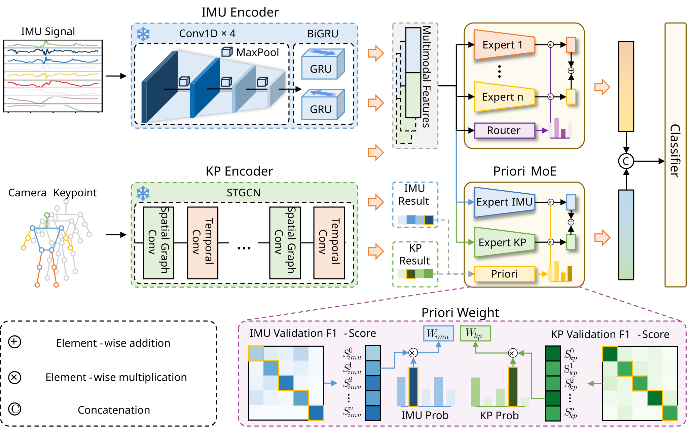

# RAMoE

Code for **RAMoE: Reliability-Aware Multimodal Fusion for Automated Safety Monitoring of Scaffold Operations Using IMU and Skeleton Keypoints**.

The main model combines a TemporalConv–BiGRU IMU encoder, a full-body ST-GCN keypoint encoder, reliability-aware modality experts, and adaptive sparse experts.



## Layout

```text
RAMoE/
├── models/
│   ├── ramoe.py                 # Main RAMoE implementation (historical class name: PRISM)
│   ├── imu.py                   # TemporalConv–BiGRU encoder
│   ├── skeleton.py              # Full-body ST-GCN encoder
│   ├── unimodal.py              # Single-modality classifier wrapper
│   └── ablations/               # Six ablation model definitions
├── training/
│   ├── trainer.py               # Shared Trainer and train_model
│   └── unimodal.py              # Construct/load/train the IMU and KP classifiers
├── experiments/
│   ├── train.py                 # Main RAMoE training
│   ├── evaluate.py              # Main checkpoint evaluation
│   ├── unimodal_evaluate.py     # IMU/KP probability and statistical comparison
│   ├── perturbation.py          # Main-model perturbation experiment
│   ├── router_analysis.py       # Adaptive-router mechanism analysis
│   └── reliability_analysis.py  # Cross-modal reliability analysis
├── data/preprocess.py           # Original SWIT preprocessing
├── utils/                      # Data loading/augmentation, evaluation, and random seeds
├── checkpoints/                # Weight manifest and local model files
└── pyproject.toml              # Package and dependency configuration
```

The four core model implementations retain their original contents and state-dictionary keys. `RAMoE` is an alias for the original `PRISM` class. This revision reorganizes modules and checkpoint paths; it does not change the model structure, losses, routing behavior, data processing, or training hyperparameters.

Checkpoint loading maps stored tensors to CPU before model placement, so files saved on another CUDA device can be used on a single-GPU machine. The evaluation entry also creates its plot-output directory when needed.

Unrelated fusion models, alternative MoE/UMT/attention trainers, alternate-dataset code, duplicate PCA scripts, and the old compatibility directory trees have been removed. Use the module paths below.

## Installation

Install [Git LFS](https://git-lfs.com/) before cloning to download the included model weights:

```bash
git lfs install
git clone https://github.com/Ivan020121/RAMoE.git
cd RAMoE
git lfs pull
```

Use Python **3.13 or later**. Install from the repository root:

```bash
uv sync
```

Alternatively, with the appropriate PyTorch build available:

```bash
python -m pip install -e .
```

`uv` uses the CUDA 13.0 PyTorch index configured in [pyproject.toml](pyproject.toml). The optional `analysis` extra enables XGBoost in the reliability analysis; the analysis also supports its original fallback without XGBoost.

```bash
python -m pip install -e '.[analysis]'
```

## Data

Obtain [SWIT](https://github.com/pms5343/SWIT) separately. Set `DATA_ROOT` in [data/preprocess.py](data/preprocess.py), then run:

```bash
python -m data.preprocess
```

The loader expects per-user tuples `(imu, kp, labels)` under `dataset/`, or an existing cached `(train_set, val_set, test_set)` tuple such as `dataset/dataset_ag.pt`. Model inputs are `IMU: [N, 200, 9]` and `KP: [N, 2, 50, 17]`.

[utils/data.py](utils/data.py) preserves the original cache, split, and augmentation logic. An existing cache is loaded as-is. Match the data preparation and split cache to the checkpoint being used. Dataset files are not included.

## Weights

Only the main model and its two pretrained classifiers are retained:

```text
checkpoints/
├── manifest.json
├── README.md
├── pretrained/
│   ├── imu.pt
│   └── kp.pt
└── ramoe/
    ├── best.pt
    └── latest.pt
```

[manifest.json](checkpoints/manifest.json) records original filenames, roles, sizes, and SHA256. See [weight preparation](checkpoints/README.md) for the required source files and provenance.

The four files are versioned with Git LFS. Download and verify them from the repository root:

```bash
git lfs pull
sha256sum -c checkpoints/SHA256SUMS
```

Git stores small LFS pointers while the weight contents are held in LFS storage. Main evaluation uses `checkpoints/ramoe/latest.pt`; `best.pt` is indexed separately. [Weight documentation](checkpoints/README.md) records their historical provenance; this distribution does not claim a newly reconstructed training protocol.

## Training and experiments

Run from the repository root after preparing data and weights. Review each script's device, dataset cache, and runtime settings before execution.

| Entry | Purpose |
|---|---|
| `python -m experiments.train` | Original RAMoE training with added single-modality samples |
| `python -m experiments.evaluate` | Full-input checkpoint evaluation |
| `python -m experiments.unimodal_evaluate` | Original pretrained IMU/KP probability comparison |
| `python -m experiments.perturbation` | Main-model perturbation experiment |
| `python -m experiments.router_analysis --help` | Adaptive-router analysis options |
| `python -m experiments.reliability_analysis --help` | Reliability analysis options |

The main training script ends with the original `multi_evaluate` reports for full, IMU-only, and KP-only inputs. The standalone evaluation script evaluates full input. The shared trainer is [training/trainer.py](training/trainer.py). [training/unimodal.py](training/unimodal.py) provides `get_unimodal_models`; it loads the two files under `checkpoints/pretrained/` when their names are supplied, or runs the original unimodal training flow when names are empty.

```python
from models import RAMoE, TemporalConvEncoder, STGCN_Encoder, UniModalityModel
```

The main model expects classifier wrappers with `with_feature=True`, returning both features and logits. Each encoder produces 512-dimensional features. Model defaults and original train/eval behavior are preserved.

The six files in [models/ablations](models/ablations) retain the original ablation class definitions. `no_imu_encoder`, `no_kp_encoder`, and `no_encoders` replace specialized encoders while keeping both modalities. `no_prior` and `no_sparse` change the corresponding expert paths; `origin` is the original ablation reference. Old embedded training/PCA drivers have been removed. These definitions are not standalone experiment commands, and existing implementation issues have not been repaired in this cleanup.

## Reproducibility

Reproducing a reported score requires its checkpoint, dataset cache, preprocessing, batch size, random seed, software environment, and metric definition. The original model also draws router noise during evaluation. This organization preserves that behavior. Source/state/CPU computation compatibility has been checked against the fixed original revision; this alone does not establish reproduction of the paper's reported scores.

The original and organized evaluation entry points were additionally compared on the same **3,260 historical cached test samples**, using the indexed `latest.pt`, seed **3407**, batch size **256**, PyTorch **2.9.1+cu130**, and the same RTX 5070 Ti. Input order, logits, predictions, and the final RNG states matched exactly; the maximum absolute logit difference was **0**.

| Metric | Original and organized code |
|---|---:|
| Ten-class accuracy | 88.128834% |
| Ten-class macro F1 | 88.036637% |
| Ten-class weighted F1 | 88.036637% |
| Grouped weighted F1 | 95.506900% |

The cache SHA256 was `a4ea5ed3efb9f15e8716a9723baf0e2e52c7d637621a291246ec445da9f4ef59`. This is an inference-consistency check of existing weights, not a fresh training reproduction or validation of every ablation. The measured ten-class F1 is close to, but does not exactly reproduce, the paper's reported 88.1%.

## Citation

Citation details are withheld during anonymous review.

The ST-GCN attribution and license notice are preserved in [models/skeleton.py](models/skeleton.py).
